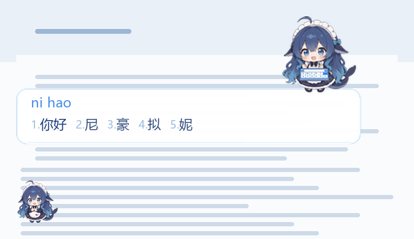

# 鲸鱼娘 · 搜狗输入法皮肤

清爽浅蓝配色的搜狗拼音皮肤。打字时候选框上方站着一个蓝发女仆鲸鱼娘，手按在键盘上敲击。

---

## 文件说明

| 文件 | 说明 |
|---|---|
| **鲸鱼娘-浅蓝2.ssf** | 动画版，**推荐**。角色双手会在键盘上起落，键帽轮流亮起 |
| **鲸鱼娘-浅蓝2-静态.ssf** | 静态版。角色不动，兼容性最好，几乎不占资源 |
| 预览.png | 效果预览图，可删 |

两个包装的是同一个皮肤，**任选一个装即可**，不建议同时装（见下方「注意事项」）。

---

## 动画能跟着打字速度变快吗

**不能，这是搜狗皮肤格式的限制，不是这个皮肤没做好。**

`.ssf` 皮肤本质上是一个压缩包，里面只有一份 `skin.ini` 配置文件和一堆图片，
**没有任何脚本、事件钩子或回调机制**：搜狗不会把「你按了一个键」通知给皮肤，
皮肤也读不到打字速度；动画（APNG）每帧时长是**写死在图片文件里**的，
装好之后就一直按固定节奏循环。所以「打得快动画就快」任何皮肤都做不到。

---

## 安装

**方式一：双击**

双击 `.ssf` 文件，搜狗会提示导入，确认即可。

**方式二：手动导入**

右键输入法状态栏 → 皮肤 → 导入本地皮肤 → 选择 `.ssf` 文件。

或：属性设置（`Ctrl+Shift+M`）→ 外观 → 皮肤 → 导入。

装好后在皮肤列表里找 **「鲸鱼娘-浅蓝2」**。

---

## 换电脑使用

`.ssf` 是**自包含**的——所有图片素材都打包在里面，不依赖任何外部文件或路径。
字体用的是系统自带的微软雅黑，不用额外安装。

所以换电脑只要：**把 `.ssf` 拷过去，双击安装**。

拷贝方式随意：U 盘、网盘、微信传文件都行。

### 前提条件

1. 新电脑要装了**搜狗输入法**（微软拼音、微信输入法读不了这个格式）
2. 搜狗版本建议 **16.9 或更新** —— 动画版依赖 APNG 序列帧，老版本可能只显示静态图

---

## 需要注意

**同名皮肤会覆盖**
两个包内部的皮肤名都是「鲸鱼娘-浅蓝2」。先用动画版、想换静态版时，直接装新的会覆盖旧的，不用先卸载。

**状态栏位置不跟着皮肤走**
第一次装完，那个小角色可能出现在屏幕某个角落，拖到顺手的位置就行，搜狗会记住（本机记忆，不随皮肤文件同步）。

**状态栏只有角色，没有按钮**
这个皮肤的状态栏去掉了软键盘、菜单、账号等按钮，只剩角色本身。
需要这些功能时：右键右下角托盘里的搜狗图标，或按 `Ctrl+Shift+M` 打开属性设置。

**中英文是不同角色**
切到中文显示蓝发鲸鱼娘，切到英文显示金发少女，这是刻意做的，不是错乱。

---

## 常见问题

**双击没反应**
搜狗可能被其他程序抢了文件关联。用「方式二」手动导入。

**提示「皮肤不支持当前模式」**
1. 先在搜狗里切回默认皮肤，等两秒，再装这个包（搜狗会缓存皮肤的解析结果，直接覆盖安装可能沿用上次的失败记录）
2. 还不行就升级搜狗到最新版

**角色不动**
装的是静态版，或者搜狗版本太老不支持 APNG。换成动画版 / 升级搜狗。

**候选框里字挤在一起，或超出白框**
每页候选词数量是搜狗自己的设置，皮肤管不了。
属性设置 → 外观 → 「每页显示候选词个数」，调成 5 个最合适。

**深色壁纸下看不清文字**
候选框的白底是半透明的（248/255），极深的壁纸下对比度会略降。
这是设计取舍——完全不透明会显得更死板。

---

## 卸载

右键状态栏 → 皮肤 → 皮肤管理，找到「鲸鱼娘-浅蓝2」删除。
或者直接切回默认皮肤，皮肤文件留在本地不影响使用。

---

## 制作说明

角色形象由 AI 绘制，输入法皮肤格式（`.ssf` / `skin.ini`）手工逆向实现。

- 候选框：角色站在白色文字条上方，双手在两个姿势间交替
- 状态栏：无底板，只有角色浮在桌面上
- 配色：`#4A8FE7` 天蓝 / `#1E3E7C` 藏蓝 / 底色 `#E7F2FE`
